# Seoul Hub

[](https://github.com/suwon98/seoul-hub/actions/workflows/ci.yml)

**서울 주요 거점의 인구 혼잡도와 시간별 추이를 지도에서 확인하고, 지역에 관한 질문과 답변을 나누는 웹 서비스입니다.**

[서비스 이용하기](https://seoul-hub.vercel.app/) · [배포 및 운영 안내](docs/manual-launch-guide.md) · [데이터 수집 설계](docs/population-data.md)

로그인 없이 대시보드를 탐색할 수 있습니다. 서울시 공식 121개 거점의 관측값을 사용하며, 인구 정보와 함께 관측 시각과 지연 상태를 표시합니다. 서울 전역의 연속적인 인구 분포나 방문 순간의 현장 인구를 측정하는 서비스는 아닙니다.

## 화면으로 살펴보기

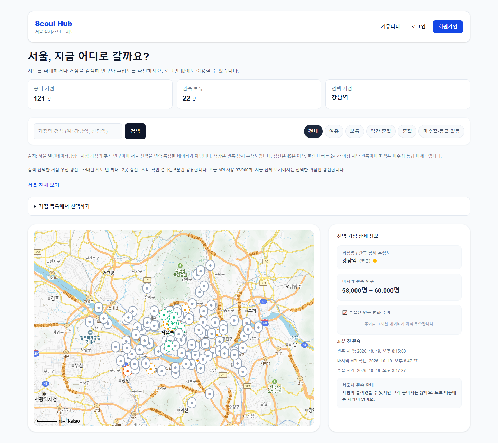

**공개 대시보드** — 로그인 없이 121개 공식 거점, 혼잡도 필터, 선택 지역의 인구 범위와 관측 시각을 확인합니다.

### 검색·선택과 인구 추이

| 거점 검색과 상세 정보 | 시간별 추이 차트 |
| --- | --- |
| 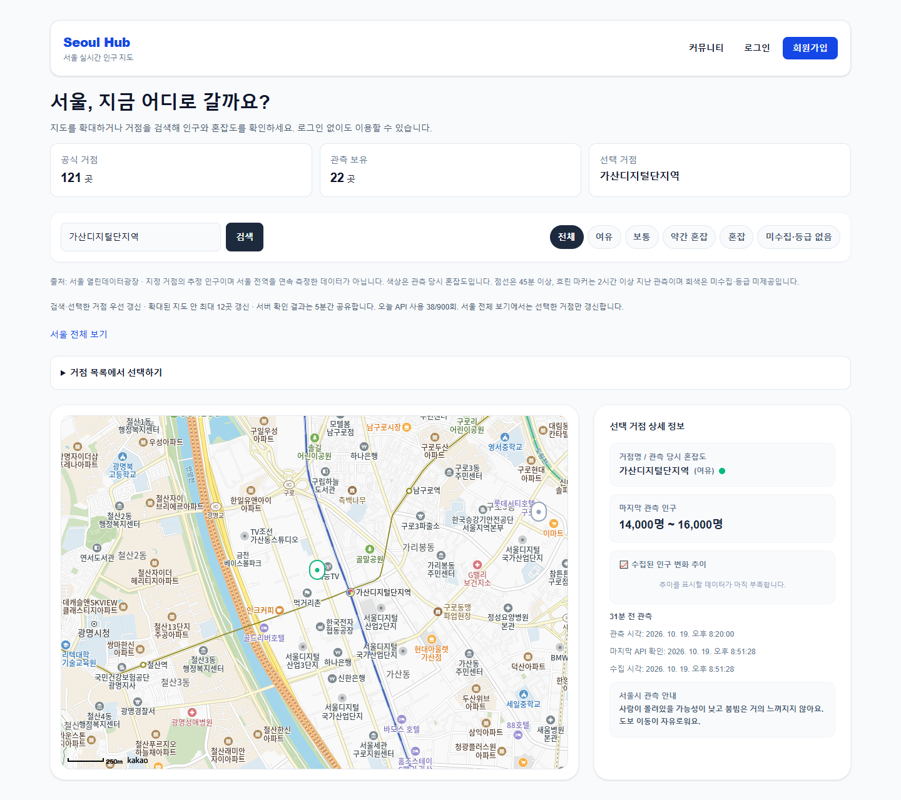 | 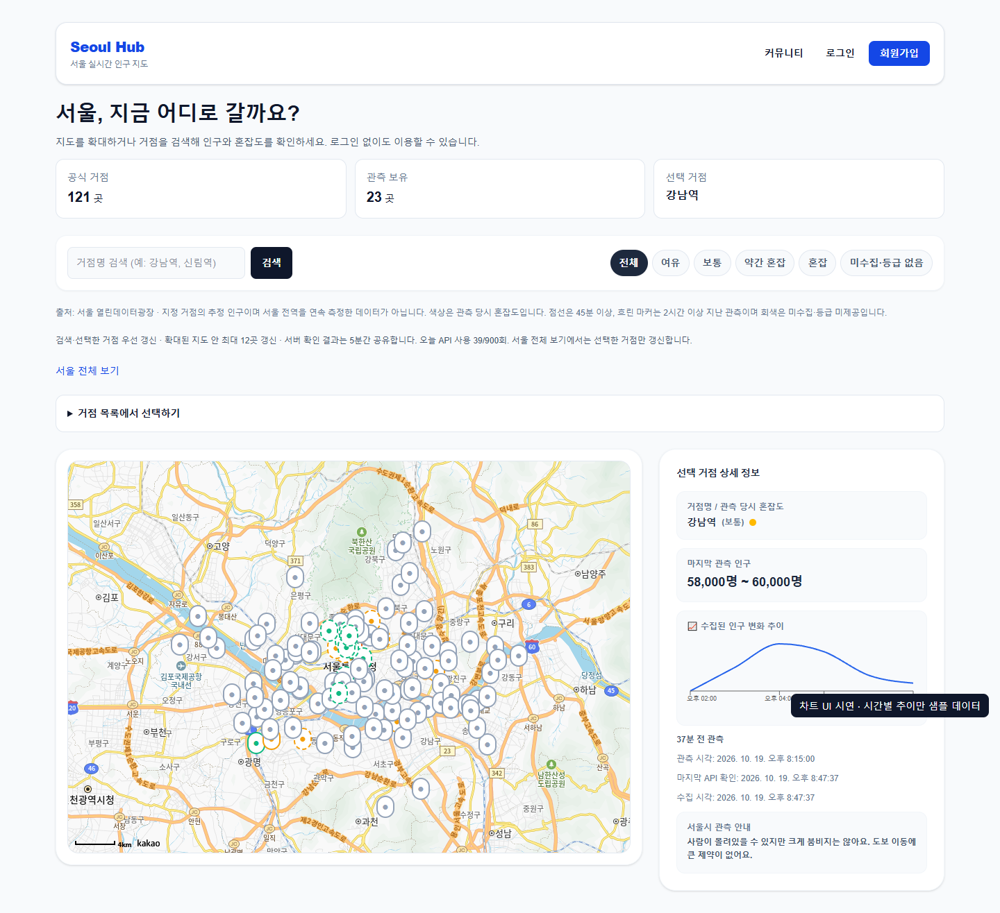 |
| 거점 검색 시 지도 중심을 이동하고 인구 범위·원본 관측·API 확인 시각을 함께 표시합니다. | 수집 이력을 차트로 표시합니다. 이 캡처의 **차트만 샘플 데이터**이며 실제 운영 통계를 의미하지 않습니다. |

### 이메일 인증과 계정 관리

| 이메일 인증 가입 | 단일 세션 로그인 |
| --- | --- |
| 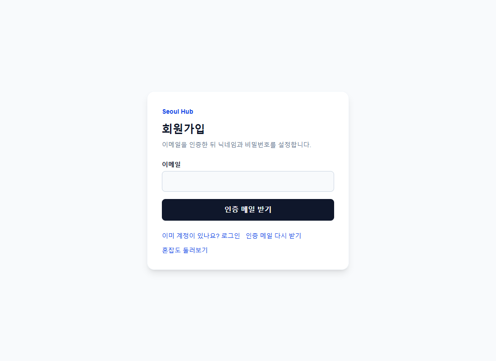 | 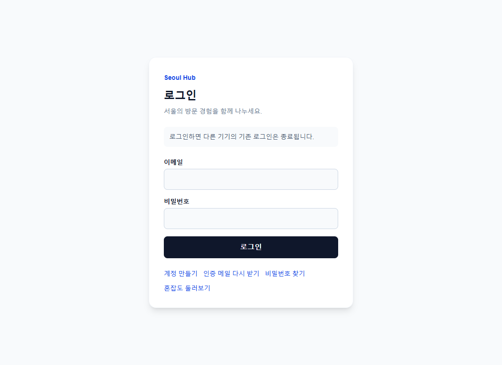 |
| 이메일 입력 → 인증 메일 → 닉네임·비밀번호 설정 순서로 가입합니다. | 새 로그인 시 기존 세션이 종료된다는 안내와 계정 복구 동선을 제공합니다. |

| 비밀번호 재설정 요청 | 계정 관리와 회원 탈퇴 |
| --- | --- |
| 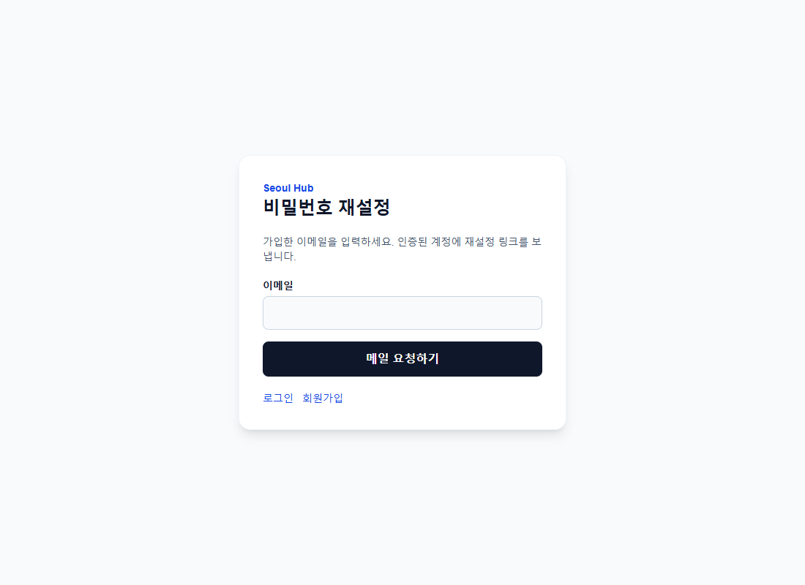 | 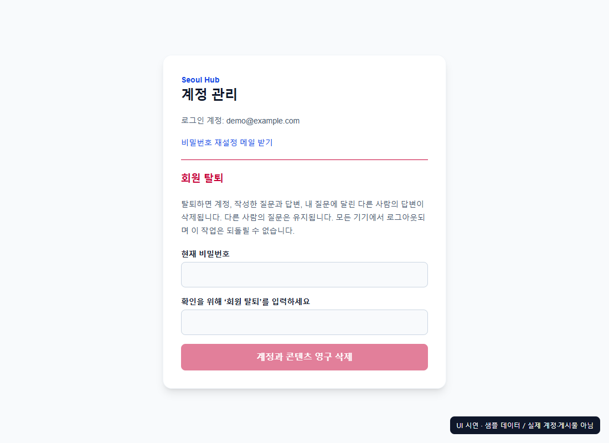 |
| 일회용 링크로 비밀번호를 변경하고 기존 세션을 무효화합니다. | 삭제 범위를 설명하고 현재 비밀번호와 확인 문구를 요구합니다. **샘플 계정 UI**입니다. |

### 지역 Q&A 커뮤니티

| 질문 목록과 작성 | 질문 상세와 답변 |
| --- | --- |
| 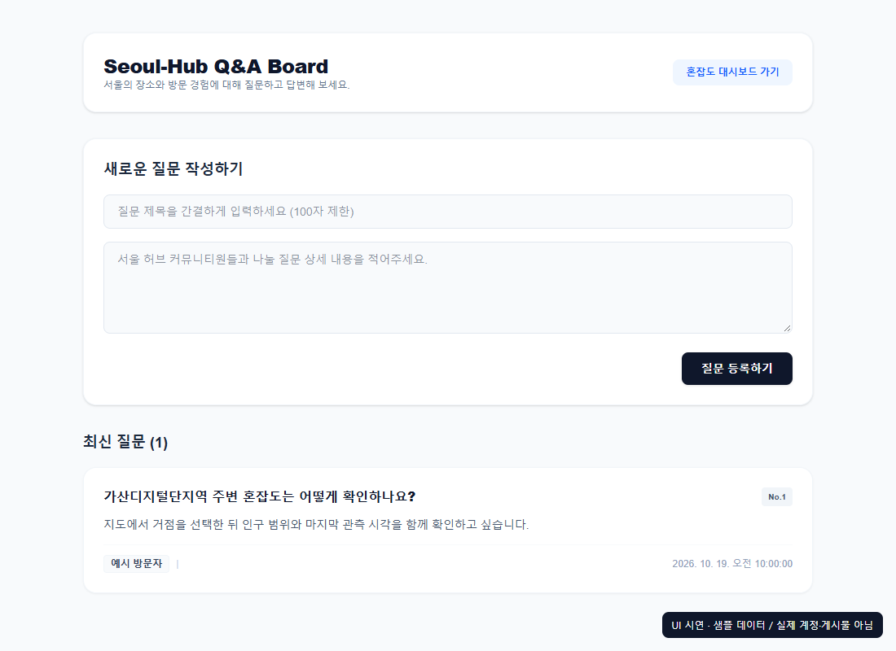 | 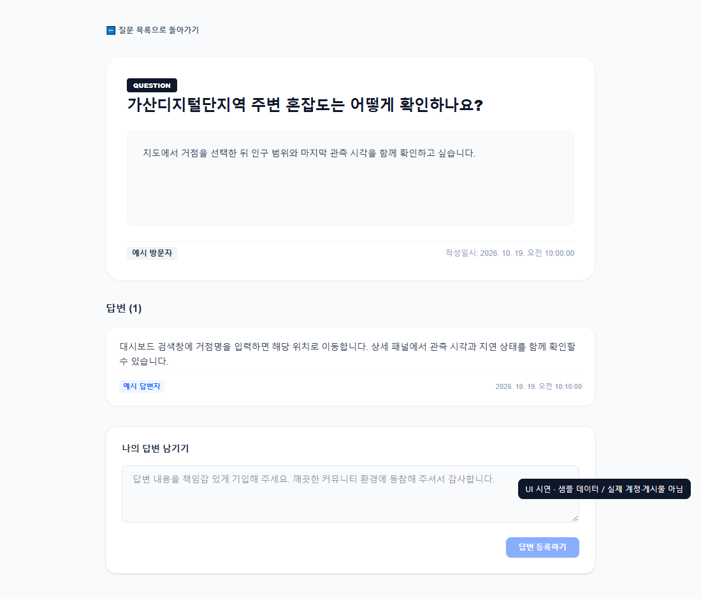 |
| 지역의 방문 경험을 질문하고 목록에서 확인합니다. | 질문별 답변을 조회하고 작성합니다. 두 화면 모두 **샘플 게시물 UI**입니다. |

<details>
<summary>모바일 대시보드 보기</summary>

390px 화면에서 검색·필터·지도·상세 패널을 세로로 배치합니다. 캡처 환경에서 가로 넘침 없이 표시되는 것을 확인했습니다. 실제 기기 전체에 대한 호환성 검증을 의미하지 않습니다.

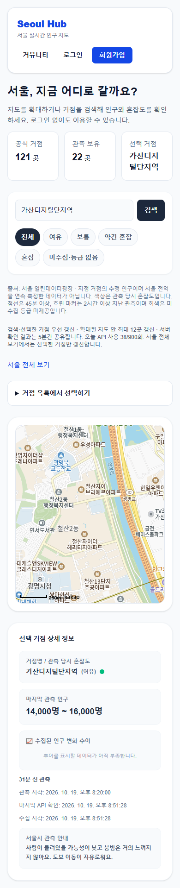

</details>

캡처 기준: 2026-10-19. 공개 화면은 운영 사이트에서 촬영했습니다. 회원 전용 화면은 브라우저 안에서 예시 응답을 사용했으며, 이미지에도 시연 표시를 넣었습니다. 실제 개인정보·인증정보·운영 게시물을 포함하지 않습니다. [촬영 범위와 데이터 구분](docs/images/README.md)

## 빠른 체험 순서

1. [서비스](https://seoul-hub.vercel.app/)에서 `가산디지털단지역`을 검색합니다.
2. 지도 위치, 혼잡도, 인구 범위와 관측 시각을 확인하고 다른 거점이나 필터를 선택합니다.
3. 계정 기능은 본인 이메일로 가입한 뒤 이용합니다. 공개 테스트 계정이나 공유 비밀번호는 제공하지 않습니다.
4. 사이트가 휴면 상태라면 첫 요청이 지연될 수 있습니다. 화면 자료와 아래 설계·테스트 근거는 사이트 접속 없이도 확인할 수 있습니다.

## 주요 기능

| 기능 | 설명 |
| --- | --- |
| 지도 대시보드 | 공식 거점 표시, 장소 검색·선택, 혼잡도 필터, 인구 상세와 시간별 추이 |
| 화면 기반 갱신 | 검색·선택 거점을 우선 처리하고 확대된 지도 화면 안의 거점을 갱신 |
| 데이터 상태 표시 | 마지막 관측 시각과 지연·오래된 관측·정보 없음 상태를 구분 |
| 이메일 계정 인증 | 이메일 확인 후 가입 완료, 일회용 링크를 이용한 비밀번호 재설정 |
| 단일 로그인 세션 | 같은 계정으로 새 로그인 시 기존 세션 무효화, 로그아웃 후 재사용 차단 |
| 계정 관리 | 현재 비밀번호 확인 후 회원 탈퇴 및 관련 데이터 삭제 |
| Q&A 커뮤니티 | 회원의 질문·답변 작성과 조회 |

## 기술 구성

| 영역 | 기술 |
| --- | --- |
| 프런트엔드 | Next.js 16, React 19, TypeScript, Tailwind CSS |
| 지도·차트 | Kakao Maps JavaScript SDK, Recharts |
| 백엔드 | Java 21, Spring Boot 4, Spring Security, Spring Data JPA |
| 데이터베이스 | MySQL 8.4, Flyway, MariaDB Connector/J / 로컬 H2 |
| 메일 | Brevo HTTPS API / 로컬 파일 수신함 |
| 운영 | Vercel, Render Docker, Aiven MySQL |
| 개발·검증 | pnpm Workspaces, Gradle, GitHub Actions |

## 아키텍처

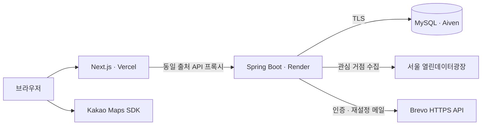

브라우저는 Next.js의 `/api/v1` 프록시를 통해 백엔드에 접근합니다. 인증 쿠키는 HttpOnly이며 운영 HTTPS에서는 Secure를 적용합니다. 서버 전용 API 키와 DB 인증정보는 브라우저에 전달하지 않습니다.

## 주요 설계

### 필요한 거점부터 수집하고 결과 공유

전체 거점을 반복 호출하는 대신 검색·선택 거점과 현재 화면의 거점을 수집 대상으로 등록합니다. 확대된 지도에서는 중심에 가까운 최대 12곳을 요청하며, 서버는 같은 거점의 확인 결과를 5분간 공유합니다.

하루 900회는 이 프로젝트가 설정한 **앱 자체 호출 예산**입니다. 예산과 다음 호출 가능 시각을 DB에 저장해 재시작 후에도 유지합니다. 목록·상세 조회는 저장 데이터만 읽으므로 사용자가 조회할 때마다 외부 API를 호출하지 않습니다.

### 최신 관측과 이력 분리

| 저장 데이터 | 목적 | 보관 기준 |
| --- | --- | --- |
| 최신 관측 | 거점별 현재 표시값 조회 | 거점별 최신 1건 유지 |
| 원시 관측 이력 | 관측 시각별 데이터 보존 | 48시간 |
| 시간별 집계 | 시간대별 인구 추이 조회 | 30일 |

같은 거점·관측 시각은 중복 저장하지 않습니다. 뒤늦게 도착한 과거 관측은 이력에 저장하되 최신 값을 덮어쓰지 않습니다. 최근 24개 완료 시간의 집계를 다시 계산해 지연 수신을 반영합니다.

화면의 갱신과 원본 관측의 갱신은 구분합니다. 관측 후 45분 이상은 지연, 120분 이상은 오래된 관측으로 표시합니다. 서버 휴면이나 원본 장애가 발생해도 마지막 관측값은 유지합니다.

### 계정 수명주기와 세션 제어

- 인증 링크는 60분, 비밀번호 재설정 링크는 20분 동안 유효하며 일회용입니다. 토큰은 DB에 해시로 저장합니다.
- 비밀번호는 BCrypt로 해시합니다. 재설정 후에는 기존 로그인 세션을 모두 종료합니다.
- 성공한 로그인은 사용자 행 잠금 트랜잭션 안에서 기존 세션을 삭제하고 새 세션을 생성합니다. 동시 로그인에서도 유효 세션 하나를 유지합니다.
- 이전 창은 다음 인증 요청에서 차단됩니다. 잘못된 비밀번호로 로그인하면 기존 세션은 유지합니다.
- 탈퇴 시 계정과 관련 콘텐츠·토큰·세션을 활성 DB에서 삭제합니다. 메일 제공업체 로그와 호스팅 백업의 보존은 별도로 관리합니다.

## 구현 과정에서 해결한 문제

| 문제 | 적용한 해결 | 확인 근거 |
| --- | --- | --- |
| 전체 거점 순환 수집의 긴 대기와 중복 호출 | 선택·화면 거점 우선 처리, 5분 공유 캐시, DB에 호출 예산 저장 | [수집·보관 정책](docs/population-data.md), 운영 지도 관측 확인 |
| 이력 정리 후 최신 표시값이 사라지는 구조 | 최신 관측과 원시 이력·시간 집계 분리, 과거 관측의 최신값 덮어쓰기 방지 | [수집·저장 설계](docs/population-data.md) |
| 다른 화면에서 돌아오면 지도가 나타나지 않는 문제 | SDK 최초 로드에만 의존하지 않고 `onReady`에서 재진입 초기화 | [대시보드 구현](apps/frontend/src/app/dashboard/page.tsx), 운영 화면 왕복 확인 |
| 같은 계정의 복수 로그인 세션 유지 | 사용자 행 잠금 안에서 기존 세션 삭제 후 새 세션 생성 | [동시 로그인 회귀 테스트](apps/backend/src/test/java/org/seoulhub/backend/SingleSessionTests.java), 운영 두 창 교차 로그인 확인 |
| MySQL과 JDBC 드라이버의 메타데이터 대소문자 차이 | 식별자 대소문자 보존을 위한 dialect 보완 | [Dialect 구현](apps/backend/src/main/java/org/seoulhub/backend/global/config/MySqlMariaDbDriverDialect.java), [MySQL 마이그레이션 테스트](apps/backend/src/test/java/org/seoulhub/backend/MigrationTests.java) |

정량 성능 개선율은 별도로 측정하지 않았습니다. 설계 설명과 자동 테스트, 사용자 운영 확인을 구분해 기록합니다.

## 로컬 실행

### 준비

Node.js 22, pnpm 11.28.5, JDK 21을 사용합니다. 아래 명령은 Windows PowerShell 기준이며 저장소 루트에서 시작합니다.

```powershell
pnpm install --frozen-lockfile
if (-not (Test-Path apps/frontend/.env.local)) {
    Copy-Item apps/frontend/.env.example apps/frontend/.env.local
}
```

이미 `.env.local`이 있다면 덮어쓰지 않고 필요한 항목만 확인합니다.

| 설정 위치 | 설정 내용 |
| --- | --- |
| `apps/frontend/.env.local` | 예시 파일의 로컬 백엔드 주소·Origin, 카카오 JavaScript 키 |
| `apps/backend/.env.properties` | 서울시 수집을 위한 `SEOUL_API_KEY` |

카카오 콘솔에는 `http://localhost:3000`을 허용 웹 도메인으로 등록합니다. 카카오 JavaScript 키는 브라우저 공개용이므로 도메인을 제한합니다. 서버용 키에는 `NEXT_PUBLIC_` 접두사를 붙이지 않습니다. 실제 설정 파일은 Git에 추가하지 않습니다.

### 백엔드와 프런트엔드 시작

터미널 1:

```powershell
cd apps/backend
.\gradlew.bat bootRun --args='--spring.profiles.active=local'
```

터미널 2 — 저장소 루트:

```powershell
pnpm dev
```

- 첫 화면: http://localhost:3000 → 대시보드
- 회원가입: http://localhost:3000/signup
- 로그인: http://localhost:3000/login
- 로컬 API 명세: http://localhost:8080/swagger-ui/index.html

로컬 프로필은 `apps/backend/data/`의 H2 DB를 사용하고, 백엔드 디렉터리의 `.env.properties`를 읽습니다. 서울시 키가 없으면 외부 수집을 생략합니다. 운영 DB를 로컬 테스트에 연결하지 않습니다.

### 로컬 이메일 확인

로컬 기본 메일 모드는 실제 발송 대신 `apps/backend/data/mail/`에 메일을 저장합니다. 가입·재설정을 요청한 후 다음 명령으로 링크를 확인할 수 있습니다.

```powershell
node scripts/read-local-mail.mjs your-test@example.com
```

## 테스트와 CI

```powershell
pnpm lint
pnpm build
pnpm test
```

프런트엔드와 백엔드를 실행한 후 HTTP 인증 흐름도 검증할 수 있습니다. 이 스크립트는 테스트 계정과 게시글을 생성하므로 로컬 file 메일 모드에서만 실행합니다.

```powershell
$env:SMOKE_FILE_MAIL_CONFIRMED="true"
node scripts/smoke-auth.mjs
```

| CI 작업 | 검증 내용 |
| --- | --- |
| `backend` | 백엔드 테스트, bootJar 빌드, Java 의존성 감사 |
| `frontend` | lint, production build, 운영 의존성 감사 |
| `mysql-migration` | MySQL 8.4에서 마이그레이션 테스트 |
| `container` | 백엔드 Docker 이미지 빌드 |

백엔드 43개 테스트에는 계정 인증·재설정·탈퇴, 토큰 재사용 차단, 동시 로그인과 단일 세션 검증이 포함됩니다. 운영에서는 실제 인증·재설정 메일 수신, 계정 수명주기, 두 창의 세션 차단, 지도 표시와 화면 복귀를 확인했습니다. 이는 보안 전수 감사나 부하 테스트 완료를 의미하지 않습니다.

## 저장소 구조

```text
apps/
  frontend/       Next.js 화면과 API 프록시
  backend/        Spring Boot API, 수집·집계, 계정 관리
scripts/          인증 smoke, 메일 확인, 의존성 감사
.github/          CI와 의존성 갱신 설정
docs/             데이터 설계, 보안, 배포·운영 문서
```

## 운영과 후속 과제

배포는 `prod` 프로필과 TLS로 검증되는 외부 MySQL을 사용합니다. Flyway가 스키마를 변경하고 Hibernate는 검증만 수행합니다. 서버 휴면 중 수집은 중단되며 모든 지역의 연속 시계열을 보장하지 않습니다.

현재는 단일 백엔드 인스턴스를 기준으로 설계했습니다. 여러 인스턴스로 확장하려면 수집 작업의 분산 잠금과 요청 제한의 공유 저장소가 필요합니다. 개인정보 안내 확정·게시, 별도 DB에서의 백업 복구 시험, 실제 모바일 기기에서의 추가 검증도 후속 항목입니다.

- [배포 및 운영 안내](docs/manual-launch-guide.md)
- [환경변수와 배포 구성](docs/deployment.md)
- [공식 거점·수집·저장 정책](docs/population-data.md)
- [보안 구현과 검증 범위](docs/security-review.md)
- [초기 데이터베이스 ERD](docs/database/erd.md)
- [아키텍처 결정 이력](docs/decision-log.md)
